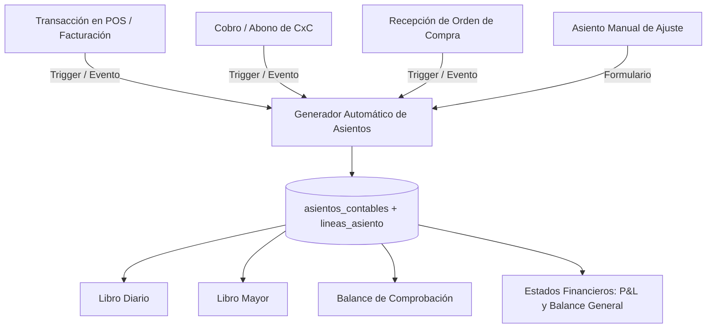

# INFORME GENERAL: Diagnóstico de Integración y Datos en Contabilidad General

**ERP ARLUC — Módulo de Contabilidad General**  
**Fecha:** 29 de Octubre de 2026  
**Autor:** Senior Software Architect & Clean Code Specialist  
**Estado:** Auditoría Técnica Exhaustiva  

---

## 1. RESUMEN EJECUTIVO Y RESPUESTA A LA PREGUNTA PRINCIPAL

> **Pregunta del Usuario:** *"No parece tener datos reales del sistema, ve uno a uno y redacta un informe individual para evaluar qué está pasando ahí, si tiene sentido o no y cómo mejorarlo."*

### 🚨 La Causa Raíz del Problema
Tras la inspección directa a la base de datos de PostgreSQL/Supabase y al código fuente, **se confirma al 100% la sospecha:**
**El módulo de Contabilidad General está completamente desconectado de los módulos operacionales del ERP.**

En la base de datos existen actualmente:
- **1,353 facturas de venta reales** registradas en los últimos 3 meses (con miles de dólares en operaciones, clientes reales, pagos en efectivo, punto de venta, pago móvil, Cashea y crédito).
- **70 abonos registrados** en cuentas por cobrar.
- **99 productos** en catálogo de inventario.

**Sin embargo, en las tablas contables solo existen exactamente 3 asientos de prueba (mock data):**
1. `AST-2026-0001` (05/10/2026): "Asiento de Apertura del Ejercicio Económico" ($15,000.00 USD).
2. `AST-2026-0002` (15/10/2026): "Registro de venta al contado según Factura #001" ($1,160.00 USD).
3. `AST-2026-0003` (18/10/2026): "Compra de mercancía para inventario según Factura Prov #882" ($928.00 USD).

No hay un solo asiento contable generado por ninguna de las 1,353 ventas del POS, ni por los abonos de los clientes, ni por las recepciones de inventario. Por esta razón, cuando entras al Libro Diario, al Libro Mayor, al Balance de Comprobación o a los Estados Financieros, **parece un cascarón ficticio con números estáticos de juguete**, porque literalmente está leyendo esos 3 únicos registros sembrados a mano.

---

## 2. MAPA DE DESCONEXIÓN DEL SISTEMA (¿DÓNDE SE ROMPE EL FLUJO?)

```
[Venta en POS] ────────► Inserta en 'facturas' ────────► ❌ NO genera asiento contable
[Cobro CxC]    ────────► Guarda en 'localStorage' ─────► ❌ NO genera asiento contable
[Compra Prov]  ────────► Inserta 'ordenes_compra' ─────► ❌ NO genera asiento contable
[Inventario]   ────────► Consulta 'productos' ─────────► ❌ NO genera asiento de costo

                                                     │
                                                     ▼
                                        [MÓDULO DE CONTABILIDAD]
                                      (Solo lee 'asientos_contables'
                                       que tiene 3 registros viejos)
```

### Detalle técnico de la desconexión:
1. **Punto de Venta (`src/pages/POS.jsx`):**
   - Cuando se completa una venta, la función `completarVenta()` realiza una inserción directa en `public.facturas` y `public.detalles_factura`.
   - **En ningún momento** se invoca el servicio `contabilidadService.crearAsiento(...)`, ni existe un disparador (`TRIGGER`) en PostgreSQL que intercepte la inserción de una factura y genere el asiento contable correspondiente de partida doble:
     - Debe: Caja General / Banco / CxC (según el método de pago).
     - Haber: Ventas de Mercancía.
     - Haber: Débito Fiscal IVA (si aplica).
2. **Cuentas por Cobrar (`src/pages/CuentasPorCobrar.jsx` / `CxCAbonoModal.jsx`):**
   - Los abonos se almacenan localmente en el navegador (`localStorage.getItem('arluc_cxc_abonos')`).
   - Al no existir una tabla relacional `abonos_cxc` conectada a contabilidad, el ingreso de dinero por cobranza no impacta las cuentas de Caja/Bancos ni rebaja la cuenta `1.1.03.01 Cuentas por Cobrar Clientes`.
3. **Compras y Proveedores (`src/pages/OrdenesCompra.jsx`):**
   - Las compras se gestionan como documentos comerciales en `ordenes_compra`, pero no causan el pasivo contable `2.1.01.01 Cuentas por Pagar Proveedores` ni acreditan la entrada a `1.1.04.01 Inventario de Mercancía`.

---

## 3. ¿TIENE SENTIDO EL DISEÑO ACTUAL O NO?

### Lo que SÍ tiene sentido y está bien diseñado:
- **Estructura del Plan de Cuentas (PUC):** El catálogo de 47 cuentas respeta la codificación estándar NIIF/venezolana (1 Activos, 2 Pasivos, 3 Patrimonio, 4 Ingresos, 5 Costos, 6 Gastos), distinguiendo cuentas madre de cuentas auxiliares operativas.
- **Lógica Matemática de Partida Doble:** Los algoritmos en frontend para validar que $\sum Debe = \sum Haber$ en céntimos enteros (evitando errores de coma flotante IEEE 754) son correctos y sólidos.
- **Dualidad Monetaria (USD y VES):** Las tablas `lineas_asiento` y las consultas soportan campos duales (`debe`, `haber`, `debe_ves`, `haber_ves`) basados en la tasa oficial.

### Lo que NO tiene sentido y debe rediseñarse:
- **Falta de Automatización:** En un ERP moderno es inaceptable que el cajero haga una venta de $50 y luego el contador tenga que ir al Libro Diario a transcribir a mano un asiento contable. El 95% de los asientos deben ser automáticos.
- **Procesamiento de Balances en Memoria del Navegador:** `fetchBalanceComprobacion` y `fetchEstadosFinancieros` descargan **todas las líneas de asientos sin paginar** y hacen el cálculo en bucles `for` en JavaScript. Cuando el sistema tenga 10,000 líneas contables, el navegador se congelará. Ese cálculo debe ser realizado por vistas (`VIEW`) o funciones agregadas en PostgreSQL.
- **Infracción de Reglas de Código:** Varios archivos (`EstadosFinancieros.jsx` con 877 líneas y `PlanCuentas.jsx` con 659 líneas) violan el límite estricto de 600 líneas del proyecto, acumulando lógica visual, formularios modales, cálculos contables y exportadores en componentes monolíticos.

---

## 4. PLAN MAESTRO DE ACCIÓN Y MODERNIZACIÓN

Para transformar el módulo en un sistema contable en tiempo real con datos verídicos:



1. **Fase 1: Mapeo Contable de Configuración (`configuracion_contable`):**
   Definir en la base de datos qué cuenta contable recibe cada método de pago:
   - Efectivo USD -> `1.1.01.01 Caja General`
   - Punto de Venta / Pago Móvil -> `1.1.02.01 Banco Nacional`
   - Zelle -> `1.1.02.02 Banco Internacional`
   - Crédito -> `1.1.03.01 Cuentas por Cobrar Clientes`
   - Ventas Netas -> `4.1.01.01 Ventas de Mercancías`
   - Débito IVA -> `2.1.02.01 Débito Fiscal IVA`
2. **Fase 2: Script de Migración Histórica (Generador Retroactivo):**
   Crear una rutina que lea las 1,353 facturas existentes en `facturas` y genere sus asientos contables automáticos con partida doble y fecha histórica. De este modo, al abrir el Libro Diario y los Estados Financieros, **se reflejarán inmediatamente los 3 meses de ventas reales**.
3. **Fase 3: Disparador en Tiempo Real en el POS:**
   Integrar en el flujo de `POS.jsx` la contabilización automática instantánea de cada venta.
4. **Fase 4: Modularización y Cumplimiento de Límites (Clean Code):**
   Dividir los componentes de más de 600 líneas en subcomponentes atómicos (árbol, modales, vistas P&L, balance).

---

A continuación se presentan los informes específicos para cada submódulo:
- [01. Plan de Cuentas](file:///c:/Users/pc/Documents/proyectos/ARLUC/docs/auditoria_contabilidad/01_INFORME_PLAN_DE_CUENTAS.md)
- [02. Libro Diario](file:///c:/Users/pc/Documents/proyectos/ARLUC/docs/auditoria_contabilidad/02_INFORME_LIBRO_DIARIO.md)
- [03. Libro Mayor](file:///c:/Users/pc/Documents/proyectos/ARLUC/docs/auditoria_contabilidad/03_INFORME_LIBRO_MAYOR.md)
- [04. Balance de Comprobación](file:///c:/Users/pc/Documents/proyectos/ARLUC/docs/auditoria_contabilidad/04_INFORME_BALANCE_COMPROBACION.md)
- [05. Estados Financieros](file:///c:/Users/pc/Documents/proyectos/ARLUC/docs/auditoria_contabilidad/05_INFORME_ESTADOS_FINANCIEROS.md)

